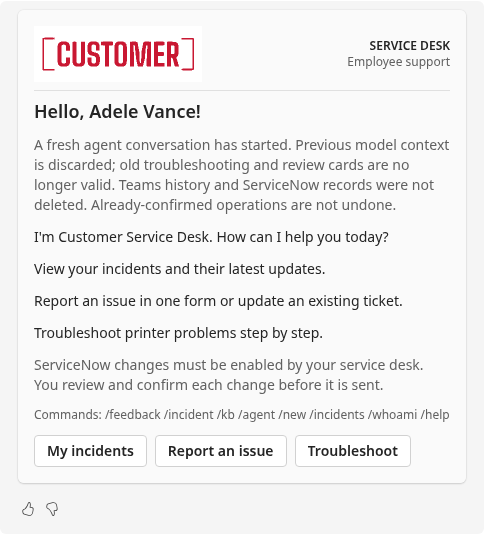
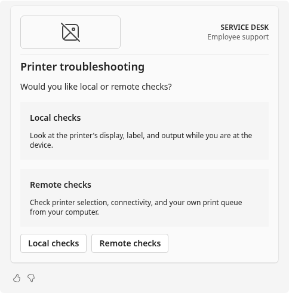
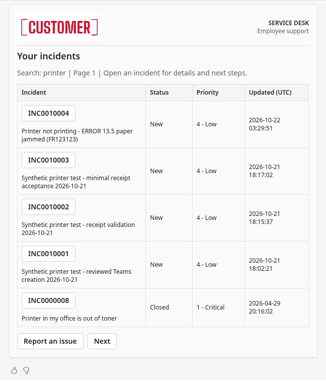
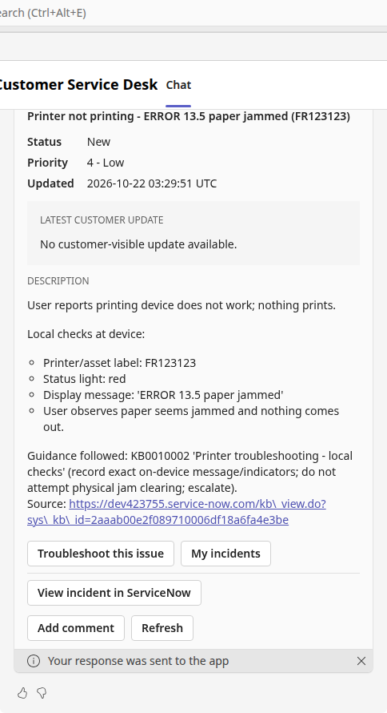
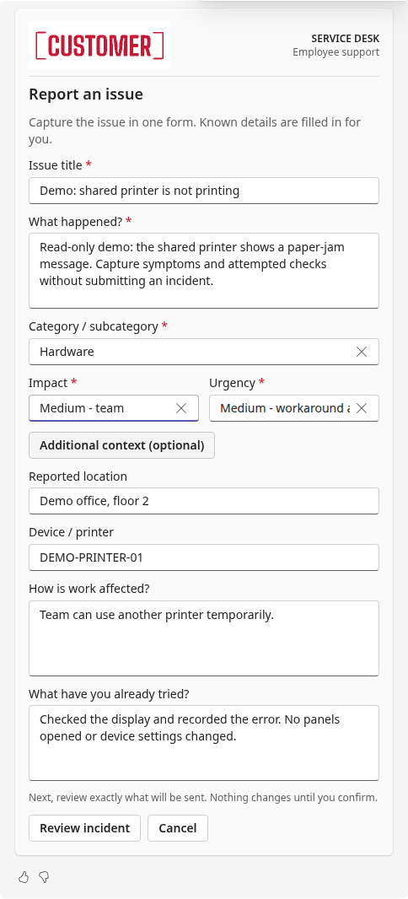
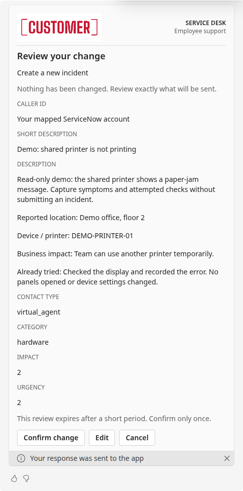

# Customer Service Desk

A Python **Microsoft Foundry hosted agent implementing Activity Protocol** for
Teams personal chat, following the
[Foundry Copilot SDK Activity sample](https://github.com/microsoft-foundry/foundry-samples/tree/main/samples/python/hosted-agents/bring-your-own/activity/github-copilot).

The application implements owned incident reads, policy-gated creation/comments/
resolution/reopening, native Adaptive Cards, and case-handling skills delivered
through **Foundry Toolbox**. The first skill is printer troubleshooting.
It uses the supplied Foundry model through the Copilot SDK, not a GitHub model
subscription. Shell/file tools, automatic config discovery, MCP tools, and
permission approval are disabled; only explicitly registered service desk tools
are exposed to the model.

## See it in Teams

[Watch or download the narrated demo (1 min 55 sec, MP4)](https://github.com/karpikpl/customer-service-desk/raw/refs/heads/main/demo-media/customer-service-desk-demo.mp4).
The recording shows the deployed agent's welcome, printer-path selection,
incident lookup, and issue-reporting form. It uses demo data and does not
submit a ServiceNow change.

### Screenshots

Select an image to view it at full size. The screenshots also show a filled
incident form, exact-change review, and cancellation.

| Welcome | Guided printer choices |
| --- | --- |
|  |  |

| Incident search | Incident detail |
| --- | --- |
|  |  |

| Incident form | Review before submitting |
| --- | --- |
|  |  |

Additional screenshots: [sourced local printer guidance](demo-media/03-printer-local-guidance.png)
and [cancelled change with no ServiceNow submission](demo-media/08-cancelled.png).

## Overview

This repository uses neutral **Customer** branding and the project/display names
`customer-service-desk` / **Customer Service Desk**. The checked-in agent service
also uses the backend name `customer-service-desk`. Existing installations with
different backend or persistence names require a deliberate migration.
Configure your own Foundry project endpoint, model,
Toolbox, tenant, ServiceNow instance, and managed secrets before deploying.
Credentials, actual identity mappings, local deployment state, and generated
Teams packages are not committed. The rebrand does not rename existing hosted
resources or migrate their session directories and state stores.

Development acceptance covered authenticated Teams greetings, incident
list/detail actions, Toolbox-backed troubleshooting, and reviewed creation and
customer-visible comments on explicitly synthetic incidents. The historical
version numbers below refer to those development runs, not a deployment of
this Customer-branded source. Writes remain disabled by default until an
administrator verifies instance policy. Knowledge retrieval is limited to
published, active articles accessible through the configured ServiceNow API
account; see [knowledge visibility](#instance-policy-and-knowledge-visibility).
Cross-user state isolation, mobile/theme coverage, and resolution/reopening
rules still require deployment-specific acceptance. Skills and the state store
are preview features; this is not a production-readiness claim.

The agent greets users by the display name supplied in their authenticated
Teams Activity, asks how to help, and suggests incidents, issue reporting, and
printer troubleshooting. Installation/member-added events and explicit
greetings/help requests use the same deterministic welcome card, without
waiting for Key Vault, Foundry state, the model, or ServiceNow. Missing display
names receive a generic greeting rather than a guessed identity. Other tenants
and group chats never receive a personalized welcome.

Card activities use Adaptive Card `fallbackText` and an Activity `summary`,
not accompanying Activity `text`: Teams splits text plus a card into separate
messages and rejects attempts to update them together. Card invokes acknowledge
promptly, then use a fresh SDK continuation turn with the original authenticated
claims and copied Activity. The original turn's connector is closed when the
invoke handler returns and must not be reused for deferred delivery.
Model replies use completed Teams message activities. Choice and information
questions use a single interactive card containing both the question and its
controls, without a separate optionless "choose an option" instruction card.
If the model ends with a plain support question without rendering a card, the
runtime gives it one bounded repair turn to call the question/choices tool.
If it still fails, it reports the failure rather than displaying a dead menu.
Informational KB answers are exempt from this repair.
Informational KB answers instead use
one formatted Markdown message with actual source links;
they do not get a KB-content card or an unrelated follow-up card.
Live tests encountered HTTP 400 from the SDK's channel-streaming final
envelope, including without attachments, so that optional channel-streaming
path is not used. Copilot's internal event streaming and automatic context
compaction are unchanged.

All cards share an original red **Customer** wordmark and a restrained masthead.
The [high-resolution logo](assets/customer-logo.png) was rendered locally, not
generated by a Foundry model. That root asset is the preview/master, not the
container's runtime asset. The 336 × 112 PNG at
`src/service_desk/assets/customer-logo.png` is packaged with the application and
embedded directly in each card as a data URI; no public image host or image-model
deployment is required. Accessible alternative text and a white image backing
preserve identity and contrast. This is synthetic branding, not an actual
customer's approved corporate identity.
Incident lists use a full-width, four-column table: incident number
and summary, status, priority, and last update in UTC. Open an incident using its
number button; five-item pagination and caller-scoped access are unchanged.
The native table headers/rows, Next/Previous navigation, and row-to-detail
actions were verified in the mapped tester's real Teams web chat on version 10.
Teams controls typography and button colors; only the logo artwork uses a fixed
brand color. The rest of the card follows the host theme.
See [the card design specification](docs/card-design.md) for sources and fallback
behavior.

Incident details include **Troubleshoot this issue**, **My incidents**, and a
direct **View incident in ServiceNow** ticket link even when chat writes are disabled.
When the instance policy enables comments, **Add comment** opens an editable
form followed by a review card by default; only **Confirm change** submits it
in that mode. An explicitly configured direct-submit mode can omit the extra
review, as described below. Read-only
policies display an explicit explanation instead of silently hiding the reason.
Comments include a server-generated **Submitted by** line containing the Teams
sender's display name (when available) and Entra user ID, followed by the user's
original comment. This attribution is shown in the review when confirmation is required;
neither card input nor model arguments can set the author. ServiceNow's journal
author remains the shared API account, not a delegated user.
Only incident details/receipts and actual KB sources link to ServiceNow.
Questions, welcome/help cards, and generic responses have no portal/home link.
These contextual links use the employee's own ServiceNow browser sign-in; the temporary
API caller mapping does not provide browser SSO.

Real Teams acceptance on version 26 returned one printer routing card containing
the question, **Local checks** / **Remote checks** buttons, and feedback controls.
There was no separate instruction card or generic ServiceNow link. This latest
card was left unclicked for the user. Live welcome and KB results also omit the
generic link; actual article links remain, and incident details retain
**View incident in ServiceNow**.

To enable **only** in-chat comments, an administrator must set `allow_comments`
to `true` in the existing `service-desk-snow-policy` Key Vault secret, preserving
all other fields and permissions, then restart the affected session compute.
This requires access to the vault's existing private endpoint; do not open its
public network or grant the runtime secret-write access as a workaround.

### Response feedback

Cards and plain Markdown KB answers use **Teams' native Like / Dislike controls**
and its optional feedback form. Cards do not also include custom thumbs buttons
or an extra feedback footer. Clients that do not display native controls can use
`/feedback` or type `Feedback: ...`; no duplicate rating surface is added.
Native Like / Dislike controls were verified on a plain-text KB reply in Teams
on version 19 and subsequently appeared beneath Adaptive Cards.
Rating handlers for historical cards with custom thumbs remain supported.
Rating submissions acknowledge without replacing the incident card, advancing
a case, or loading ServiceNow.
Feedback can also be written in chat: explicit `Feedback: ...` messages use a
backend-independent path; conservative phrase detection and a classification-only
model tool handle natural-language and mixed feedback/support requests.
Printer symptoms such as “still not printing” are not assistant feedback.

Feedback telemetry goes **only to the existing Application Insights resource**,
using an independent OpenTelemetry log provider and Azure Monitor exporter.
It does not propagate to console/global OTLP/A365 log providers, write a
ServiceNow comment, or create a feedback database. Exporter offline disk storage
is disabled. Original Teams messages and existing Copilot conversation history
are otherwise unchanged; this is not deletion of the source chat.
Common secret formats and email addresses are redacted and feedback text is
bounded to 4,000 UTF-8 bytes; this is not a comprehensive DLP service.
Do not include passwords or unnecessary personal details.

Configure `DESK_FEEDBACK_CONNECTION_STRING` securely in the azd environment
using the existing Application Insights connection string. The dedicated
variable deliberately does not enable global request/body collection.
No new Application Insights or storage resource is created.
Capture is buffered in memory and exported in batches, so acknowledgments mean
received for telemetry, not guaranteed durable storage; process termination or
ingestion failures can lose queued records. Missing configuration is an explicit
failure, not a false “saved” response.

Both card-rating directions, explicit chat feedback, and model-classified mixed
feedback/support messages were verified in the mapped tester's Teams chat and
queried back from the existing Application Insights resource. Copilot tool
callbacks reuse the already-authorized turn capability rather than reading
Foundry request context, which is not propagated into the SDK callback task.

In **Application Insights → Logs**, filter and deduplicate transport retries:

```kusto
customEvents
| where timestamp > ago(7d)
| where name == "service_desk.feedback"
| extend feedback_id = tostring(customDimensions.feedback_id)
| summarize arg_max(timestamp, *) by feedback_id
| project timestamp,
    source = tostring(customDimensions.feedback_source),
    rating = tostring(customDimensions.feedback_rating),
    feedback = tostring(customDimensions.feedback_text),
    response_id = tostring(customDimensions.response_id),
    conversation_scope = tostring(customDimensions.conversation_scope),
    redacted = tostring(customDimensions.feedback_redacted)
| order by timestamp desc
```

`feedback_source` is `card`, `native`, `conversation`, or `command`; `feedback_rating` is `positive`,
`negative`, or `neutral`. `event_type=service_desk.feedback` and
`is_feedback=true` are stable custom dimensions. Identity/conversation scope is
hashed, not raw Entra IDs or display names. Native ratings target Teams'
`replyToId`; conversational feedback uses a reply target or the latest response
remembered in that process, and can be unlinked after restart.
From the associated Log Analytics workspace, use `AppEvents`, `TimeGenerated`,
`Name`, and `Properties` instead of the Application Insights table/column names.

### Performance telemetry

Application spans use the **existing Foundry-hosted OpenTelemetry pipeline**.
No additional provider, exporter, monitoring resource, or connection string is
installed for performance tracing; the isolated feedback exporter is unchanged.

`service_desk.turn` summarizes normal support messages and deferred card actions.
Its `desk.route` distinguishes commands, card actions, greetings, feedback and
model-led conversation. Child spans cover initialization, conversation-lock
wait, Copilot startup/session setup, model-call events, registered tools,
ServiceNow requests, Toolbox discovery/loading, durable state operations and
Teams card/knowledge delivery. SDK tool callbacks explicitly restore the
captured OTEL parent and per-turn counters without changing authentication.

Turn attributes include total milliseconds (`desk.duration_ms`), successful
first-content delivery milliseconds (`desk.first_content_sent_ms`), agent runs,
tool calls/failures, invalid tool inputs, model retries and question-card repairs.
Model calls and input/output/cache token counts are included when the SDK emits
the relevant events. `desk.model_count_source` on the agent span identifies
call-start events, usage fallback, or unavailable data; missing model counts
must not be interpreted as zero for model-led turns. Model-call spans measure
SDK-event boundaries, not an independent network benchmark.

First-content timing ends after a successful Teams send/update, not when the
client actually renders the message. It excludes the initial invoke
acknowledgment and platform routing/cold provisioning before the handler.
Cold initialization and Copilot startup flags describe this process, not the
Foundry sandbox lifecycle. Sampling, batching and process termination can cause
missing telemetry.

Application-added attributes contain only operation names, timings, counts,
flags, HTTP status and exception **class names**. They do not record prompts, messages, feedback,
ticket/KB contents, user identifiers, state keys, URLs, tool arguments/results,
exception messages or stack traces. Existing platform/model telemetry has its
own collection policy; this instrumentation does not change it.
The host can still add its standard agent/session/conversation correlation
identifiers to spans.

In the associated **Log Analytics workspace**, compare turn latency:

```kusto
AppDependencies
| where TimeGenerated > ago(1h)
| where Name == "service_desk.turn"
| extend Route = tostring(Properties["desk.route"]),
         Operation = tostring(Properties["desk.operation"]),
         FirstContentMs = todouble(Properties["desk.first_content_sent_ms"]),
         AgentRuns = toint(Properties["desk.agent_runs"]),
         ModelCalls = toint(Properties["desk.model_calls"])
| summarize Turns=count(),
            P50Ms=percentile(DurationMs, 50),
            P95Ms=percentile(DurationMs, 95),
            FirstContentP95Ms=percentile(FirstContentMs, 95),
            AvgModelCalls=avg(iff(AgentRuns == 0, 0, ModelCalls))
  by Route, Operation
```

Filter `OperationId` to a selected turn and list all `service_desk.*` dependencies
to inspect its breakdown. Child spans can overlap: do not sum all nested
durations and treat the result as total elapsed time. In Application Insights
Logs, the corresponding table/columns are `dependencies`, `timestamp`, `name`,
`customDimensions`, `operation_Id`, and `duration`.

### Deterministic chat commands

Type these in the **Teams message composer**, not the Copilot CLI command line.
They route before greetings, case-choice matching, and model orchestration.
Neither valid commands nor unknown/invalid slash commands call the model.
Commands require the authenticated Foundry Teams endpoint, the configured tenant,
and a personal chat. Data commands also enforce the caller mapping and instance
policies. Rich-card forms use the same deterministic routing.

| Command | Behavior |
| --- | --- |
| `/feedback` | Open a text/rating form. `/feedback YOUR TEXT` records inline feedback with a neutral rating. No ServiceNow write. |
| `/incident` | Open incident intake when creation is enabled; optional issue title after the command. `/incident INC0012345` opens that owned incident instead. Review is required by default. |
| `/kb` | Open a search form, or use `/kb printer` to search published, active knowledge accessible to the integration account. Does not publish drafts or bypass ServiceNow API permissions. |
| `/agent` | Show host-reported agent/version, application/model/harness details, and advertised skill names. Does not reveal credentials, private config, or system instructions. |
| `/new` | Start a fresh logical agent conversation within the same Teams chat; see reset semantics below. |
| `/incidents` | List **your** incidents across all statuses, including closed ones, five per page. `/incidents 2` opens page 2 of the unfiltered list; `/incidents printer` searches your incident titles. Search-result Next/Previous buttons preserve the query. Never lists other callers' incidents. |
| `/whoami` | Show your authenticated Teams identity and your own temporary ServiceNow caller ID, or explicitly “Not mapped.” Does not accept identity overrides. |
| `/help` | List the supported commands. |

Commands are case-insensitive. Invalid arguments and unknown commands return
explicit usage guidance rather than falling through to the model.
`/feedback` form and inline submissions use `feedback_source=command` in the
same `service_desk.feedback` custom events and App Insights-only sink.

`/new` discards the current caller-scoped Copilot SDK session, then conditionally
rotates a persisted conversation generation in Foundry state. Subsequent model
sessions, case state, and reviews use the new generation; old case/review cards
cannot operate in it. Confirmation also checks that its generation is current.
The reset pointer is refreshed on stateful turns under the existing state-retention
policy. The old SDK session is discarded before rotation so expiration cannot
revive pre-reset model history. A failed reset is reported, not claimed as success.
Teams chat history, ServiceNow records, and existing telemetry are not deleted;
already-confirmed or in-flight operations are not undone. `/new` is therefore
not a request to create a second physical Teams chat.

Incident creation remains unavailable where administrator policy disables it.
Commands do not bypass incident ownership, write policy, or ServiceNow API
permissions.

## Service-desk flows and interaction budgets

Use these flows in an authenticated **Teams personal chat** with a mapped test
user. The richer intake, no-allowlist knowledge retrieval, optional direct-submit
mode, `/incident NUMBER` shortcut, and incident-title search describe the updated release behavior;
they are not claims that the observed live v31 already implements them. Verify
the deployed version and configuration before a demo.
A **user interaction** is one sent message or one submitted card action;
typing into several fields before pressing Submit is still one action.
Receiving a reply or invoke acknowledgment is not another interaction.
Opening a ServiceNow browser link is an external navigation, not a bot turn.
One user interaction normally produces one application turn, but a model-led
turn can contain several model requests and tools. **An agent run, a model
call, a tool call, and a human turn are different counts.**

The budgets below are source-derived happy paths, not measured end-to-end
benchmarks. They exclude retries, edits, pagination, optional greetings, and
additional questions. `0` model calls means a deterministic application route,
not zero ServiceNow/state/Toolbox work. For model-led routes, count the actual
SDK events; do not assume one model call per message.

### Entry, read, and search flows

| Flow | What the user does and sees | User interactions | Model work |
| --- | --- | --- | --- |
| Welcome | Install/member-added event displays a personalized welcome; alternatively send `Hi` or `/help`. Welcome buttons offer incidents, intake, and troubleshooting. | 0 for the event; 1 message for greeting/help | 0 calls |
| Agent/identity | `/agent` shows deployed version/model/skill metadata; `/whoami` shows only the authenticated user's mapping. | 1 message | 0 calls; catalog/config reads can still take time |
| List owned incidents | `/incidents`, or **My incidents**, returns five rows across all statuses. **Next/Previous** changes the page. | 1 message or click; +1 click per page | 0 calls |
| Search owned incident titles | `/incidents printer` searches literal title text in caller-owned incidents. **Next/Previous** preserves the search instead of paging unrelated tickets. | 1 message; +1 click per matching-results page | 0 calls |
| Open an incident | `/incident INC0012345`, or click its number in the list. Details include latest customer update, description, state, priority, and contextual actions. | 1 from a known number; 2 total via list then number | 0 calls |
| Natural-language list/view | “Show my incidents” or “Show INC0012345.” The model uses the same guarded list/get tools and returns cards. | Usually 1 message; +1 per follow-up | Model-led; variable calls |
| Natural-language incident search | “Which of my tickets is about printing?” can use `search_my_incidents` to filter titles on the server, retaining caller ownership and matching-results pagination. This is literal title search, not full-text/semantic search of descriptions or journal history. | Usually 1 message; +1 per matching-results page or clarification | Model-led; variable calls |
| Direct KB search | `/kb Automatic Replies` searches immediately. `/kb` opens a query form, then **Search knowledge** submits it. Results link to actual articles. | 1 message with query; 2 interactions via form | 0 calls |
| Natural-language KB answer | “How do I set an out-of-office reply?” selects a relevant skill/search and returns a concise Markdown explanation with source links. | Usually 1 message if the request is clear | Model-led; search/tool loops may need multiple calls |
| Troubleshoot a ticket | From details, **Troubleshoot this issue** supplies that owned incident's facts to the relevant skill. It does not update the ticket. | +1 click from details, then questions/checks below | Model-led |

Knowledge search is currently **literal article-title-fragment matching**, not
semantic/full-text search or keyword-AND search, and returns up to three
articles. Prefer `/kb Deleted Email`, not a long symptom sentence. A natural
language request lets the model select a shorter fragment and retry once with
a shorter relevant term. An empty result is not evidence that no article
exists. Article number alone is not a unique identifier in this demo instance:
verify title, knowledge base, and the returned `sys_kb_id` link.

### Printer: routing → question → check → outcome → incident

1. Send **“My printer isn't printing.”** The printer skill asks **Local checks**
   or **Remote checks** on one card and waits. It does not assume a path.
2. Choose one path. The continuation retrieves only its matching article:
   local means safe observations at the device; remote means checks from the
   user's computer, **not** remote-control access.
3. Answer only missing questions using the card's text field and **Continue**
   or **I don't know**. For example: printer label, visible error, operating
   system, location, or work impact. A question is not an attempted fix.
4. A safe actionable check has **That worked** / **Still not working** buttons,
   plus **Create incident** when permitted. Actual KB links stay with the check.
   Each outcome continues the model-led case; “That worked” does not resolve an
   existing incident, and “Still not working” does not create one.
5. If escalation is needed, **Create incident** opens the structured intake
   with the saved case summary. Complete/correct the fields, submit, and confirm
   the exact review in the default mode. A verified receipt, not a troubleshooting
   outcome, establishes that ServiceNow changed.

For an illustrative path with **one missing-information answer and one check
outcome**, the count is **7 interactions**: initial message → path click →
answer submission → outcome click → intake click → form submission →
confirmation. This is **4 model-led application turns**, not four guaranteed
model calls; intake/form/review confirmation are deterministic. With `q`
information answers and `c` check outcomes, that same escalation path costs
`5 + q + c` interactions in review mode, or `4 + q + c` in direct-submit mode.
Do not force a check when a local hardware warning calls for immediate escalation;
the actual case may have no outcome step or may need more than one.

For **“What are the basic troubleshooting steps for a printer?”**, the expected
flow is just message → path click → path-specific Markdown overview:
**2 interactions**, no unnecessary symptom questionnaire or intake.
An explicit path, such as **“What remote printer checks can I try from my
computer?”**, can avoid the routing question: **1 interaction** if sufficient.
Saved selections and supplied facts should not be requested again.

### Create, comment, resolve, and reopen

`DESK_REQUIRE_WRITE_CONFIRMATION=true` is the default. A structured form
submission prepares a review containing the exact proposed values;
**Confirm change** submits, **Edit** reopens the form, and **Cancel** writes
nothing. Reviews expire after `DESK_CONFIRMATION_TTL` (600 seconds by default).

With `DESK_REQUIRE_WRITE_CONFIRMATION=false`, an **explicit structured form
submission or explicitly requested model action** can execute without that
separate review. Merely describing a symptom, selecting a support path, or
reporting a troubleshooting outcome is not a write request. This switch removes
one redundant confirmation interaction; it does not enable writes, change
ownership, let the client choose the caller, disable validation/state claims,
or make unknown-outcome writes safe to retry. Verify the deployed environment;
the v31 timing observations below do not establish this setting.

| Operation | Default review-mode flow | Interactions | Direct-submit budget |
| --- | --- | --- | --- |
| Create | `/incident` → complete intake and submit → **Confirm change** → receipt | 1 message + 2 clicks = **3** | **2** |
| Natural-language create | “Create an incident for my printer problem” → prefilled intake → submit → **Confirm change** | Usually **3** | Usually **2** |
| Comment, starting at details | **Add comment** → enter customer-visible text and submit → **Confirm change** | **3** clicks | **2** |
| Resolve, starting at eligible details | **Resolve** → choose permitted resolution code and enter notes → submit → **Confirm change** | **3** clicks | **2** |
| Reopen, starting at eligible details | **Review reopening** → **Confirm change** | **2** clicks | **1** explicit action |
| Complete model-requested comment/resolve/reopen | Explicitly request a supported change with all required facts → review → **Confirm change** | Usually **2**, more if information is missing | Usually **1**, if the request is complete and explicit |

All card-only paths above use **zero model calls**; natural-language create and
the last row are model-led. Natural-language create always opens the richer
prefilled form rather than interviewing for fields one by one or directly
creating from model arguments. Even with review disabled, the employee must
submit that form; the model request alone does not create the incident.
To begin from chat rather than an already open incident, add one interaction
for `/incident NUMBER`, or two for `/incidents` then its number. Each review
edit/resubmission adds interactions; never count it as a successful write.
Resolve/reopen buttons depend on actual instance states and allowed transitions;
they are not universally enabled. Comments are customer-visible `comments`,
never internal `work_notes`, and carry server-generated Teams submitter attribution.

The create form collects **short description, detailed description, a combined
category/subcategory choice, impact, and urgency** together. Classification,
impact, and urgency must be nonblank at submission. The combined classification
options come from the instance's actual `sys_choice` metadata, cached for five
minutes, rather than invented category names. Impact/urgency use controlled
choices. Optional fields are `reported_location`, `device`, `business_impact`,
and `attempted_steps`. The server appends these as explicitly labeled context
to the description, not arbitrary ServiceNow reference IDs.
The server sets the mapped `caller_id` and
`contact_type=virtual_agent`; it does not accept arbitrary assignment or priority.
Priority is instance-derived from impact/urgency and ServiceNow rules, not a
freely selected incident priority.

Both confirmation modes use the same durable **prepare → claim → write →
receipt** engine through `Actions.submit`. Forms carry an opaque stable
`action_id`; repeating the same submission reuses its existing claim/receipt
instead of issuing a second write. Forms also carry a current caller/conversation
`scope_token`. Non-review submission rejects older forms missing the required
ID/token and rejects a token from another conversation/generation; the stable ID
alone is not authorization. Explicit model-requested comment/resolve/
reopen actions derive a stable ID from the authenticated Activity, operation,
and target, and must still pass ownership, state and policy guards. These
application deduplication claims do not turn ServiceNow into a distributed
transaction: an unknown outcome still requires reconciliation, not a new ID
and blind retry.

### Feedback, cancellation, and reset

- Native **Like/Dislike** is a feedback interaction, not a support continuation;
  the client's optional feedback dialog may add UI steps. No model or ServiceNow
  write is involved. `/feedback Good answer` or `Feedback: Good answer` is
  **1 message**; `/feedback` → complete form → submit is **2 interactions**.
  Ambiguous or mixed natural-language feedback/support can use the model.
- A review's **Cancel** costs **1 click** and submits no write. A pending case
  choice or outcome never doubles as confirmation.
- **Start a new case** costs **1 click** and clears procedural case state only;
  it is not a full conversation reset. `/new` costs **1 message**, uses no
  model, discards model context, and invalidates old cases/reviews. Neither
  deletes Teams messages, ServiceNow records, or telemetry, nor undoes
  already-confirmed/in-flight actions.

## Realistic demo scenarios from the instance knowledge

These examples are based on the actual published, active, admin-visible demo
corpus observed during investigation (**44 articles**, not a guarantee that
every API account or browser user can read all 44). Broader/older knowledge is
acceptable demo material, but it is not a current incident or availability feed.
Reset with `/new` between unrelated scenarios, or explicitly ask to start a new
topic, so pinned case state does not distort the demonstration. Do not tell the
agent which internal tool to call; use ordinary employee wording.

| Employee scenario | Expected source and realistic behavior | Interaction target |
| --- | --- | --- |
| “What basic printer checks can I try?” → **Local checks** | **KB0010002 — Printer troubleshooting - local checks**. Return only the local overview and its actual link; no remote queue steps. There is also an unrelated Life Feed template with this same number, so validate the title/link, not just the number. | **2**, model-led |
| “My printer isn't printing; I'm at my computer and need remote checks.” | **KB0010001 — Printer troubleshooting - remote checks**. Ask only missing OS/queue/network facts, guide the user's own queue and one agreed non-sensitive test. Never imply remote-control access or clear a shared queue. | **1 + q + c** through outcomes; add intake/submit/confirm for escalation |
| “I'm next to the printer; its display says paper jam.” | Local printer article. Capture exact visible message/asset/location/impact and escalate; do not instruct opening panels or clearing the jam. Use synthetic data in any demo incident. | Variable; explicit local path avoids routing click |
| “I accidentally deleted an email. Can I recover it in Outlook on the web?” | **KB0000030 — Deleted Email Recovery**. Use OWA/Outlook recovery instructions; its 14-day retention statement is a dated article assumption, not a universal tenant guarantee. | Usually **1**, model-led; `/kb Deleted Email` is a 1-message zero-model discovery alternative |
| “How do I set an out-of-office reply?” | **KB0000025 — Automatic Replies (Out Of Office)**. Match the requested client and explain from the source. **KB99999999 — Microsoft Outlook Issues** is actually Outlook 2010 automatic replies, not a general Outlook troubleshooting guide. | Usually **1**; +1 if client clarification is necessary |
| “How do I create an email signature?” | **KB0000024 — Create An Email Signature**. Give concise sourced instructions; don't force incident creation for an informational question. | Usually **1**, model-led |
| “My laptop account is locked.” | **KB0005012**, laptop account-lockout article. Explain only applicable sourced guidance; its sample 30-minute wait and sample phone numbers are not verified current enterprise policy/contact details. No unlock/password reset is performed by the agent. | Variable, depending on missing facts |
| “I received a suspicious email. What should I do?” | **KB0000028**, phishing article. Cite the returned title/link, avoid requesting credentials or sensitive message content, and distinguish article guidance from a verified current reporting process. | Usually **1**, model-led; further evidence collection can add turns |
| “An app is frozen on my Mac.” | **KB0000013**, macOS force-quit article. Warn that unsaved work can be lost before any force-quit instruction; match the user's platform rather than presenting Windows steps. | Usually **1**, model-led |

Avoid a “current outage” demonstration based on **KB0000001 — Sales Force
Automation is DOWN** or **KB0000002 — Email Interruption Tonight**: they are
historical notices, not proof of today's service state. **KB0000008**, Apple VPN,
contains legacy L2TP/older-OS material; do not present it as a current universal
VPN setup guide. When intentionally demonstrating old content, state its scope
and age and show the source; never manufacture freshness or a current outage.

### Observed latency versus optimization targets

The following are **individual live v31 observations**, not averages, SLOs,
comparative benchmarks, or promises. They measure application-side completed
delivery, not client rendering or total time spent reading/typing:

| Observed turn | Elapsed | Model calls observed | Interpretation |
| --- | --- | --- | --- |
| `/agent` | ~0.93 s | 0 | Deterministic metadata route |
| Cold `/incidents` | ~3.96 s | 0 | Zero-model does not remove cold initialization/API latency |
| Generic printer request → Local/Remote card | ~6.19 s | 1 | One routing interaction, including skill/model work |
| **Local checks** selection → KB answer | ~15.46 s | 2 | One human click caused two model calls and retrieval/delivery work |

The two observed v31 printer turns sum to about **21.65 s** of application
processing, excluding user think/click time. That example has **2 user
interactions, 2 agent runs, and 3 observed model calls**. Do not apply the
informational-overview timing to every active-issue path.

### Customer-release Teams acceptance

Initial live checks on **v32** verified the full Customer source release without
performing a ServiceNow write:

- `/agent` showed the expected version, chat model, preserved persistence
  settings, and **write confirmation required**.
- The packaged red **Customer** PNG rendered in the real Teams card (336 × 112
  native image, displayed at 168 × 56), not merely in a local preview.
- `/kb Automatic Replies` returned **KB0000025**, previously excluded by the
  application allowlist. This verifies broader published knowledge retrieval,
  not permission bypass or access to every article.
- `/incidents printer` returned caller-owned filtered results with **Next**;
  `/incident INC0010004` directly opened that user's owned incident.
- `/incident` displayed actual instance classification choices: six categories
  with valid subcategories in the observed instance, impact/urgency, and optional
  context. These are observed metadata, not six universal ServiceNow categories.
- A synthetic form submission reached Review with the exact
  `contact_type=virtual_agent`, hardware classification, `impact=3`, `urgency=3`,
  and explicitly labeled context. **Cancel** confirmed nothing was submitted.
  This exercised preparation/cancellation, not create/resolve/write acceptance.
- A natural-language create request immediately opened the prefilled form in
  **one observed model call**, rather than asking for each missing field.

The following approximate v32 times were **single browser end-to-end observations**,
not the application-span metric in the v31 table and not benchmarks:

| Observed browser path | Approximate elapsed | Model-count basis |
| --- | --- | --- |
| `/kb Automatic Replies` → results | 5.4 s | 0 by deterministic routing |
| `/incidents printer` → filtered results | 4.1 s | 0 by deterministic routing |
| `/incident INC0010004` → details | 3.9 s | 0 by deterministic routing |
| `/incident` → intake | 3.6 s | 0 by deterministic routing |
| Natural-language create → prefilled intake | ~8 s | 1 observed model call |

The human-interaction budgets above remain code-derived happy-path estimates,
separate from these observed elapsed times and model events. Browser timings
include different boundaries from application delivery spans; do not compare
them as like-for-like before/after latency improvements.

The initial natural-language create check exposed an extra generic “Use card
below” instruction card. This was corrected and live-verified in **v33** below;
it is not a remaining duplicate-card issue.

#### Final verified v33 release

The active release is **v33**, full Customer package `demo-20261022-r2`.
Actual Teams `/agent` confirmed version 33, the same `gpt-5.2` route, and
**confirmation required**. The Customer Teams app package **1.0.1** was uploaded
and added successfully while preserving the existing conversation/history;
the browser title now reads **Customer Service Desk | Microsoft Teams**.
The packaged card logo still loads at 336 × 112 native resolution.

- A fresh natural-language create request returned **exactly one prefilled
  form**, without a “Use card below” card. Blank impact/urgency stayed blank,
  not invented. It used **one actual model call**: application span **8.397 s**,
  browser observation approximately **10.3 s**.
- After `/new`, the exact basic-printer question returned the **Local checks /
  Remote checks** card. Selecting **Local checks** returned local-only
  **KB0010002** Markdown with the real article link, not the remote procedure.
  The reset is setup, excluded from the two-interaction overview budget.
- This printer overview used **2 human interactions and 4 actual model calls**:

| v33 observed printer turn | Application span | Actual model calls | Approximate browser elapsed |
| --- | --- | --- | --- |
| Basic-printer question → path choices | 12.033 s | **2** | 14.1 s |
| **Local checks** → local-only KB overview | 15.350 s | **2** | 18.6 s |

The application spans total **27.383 s**; the two browser observations total
approximately **32.7 s**, excluding user reading/think time. The historical v31
sample had **1 + 2 calls**, whereas this v33 run had **2 + 2**: these are
observations, not guaranteed call counts or a controlled before/after benchmark.
The v33 spans showed **no tool failures, retries, or question-card repairs**,
so those mechanisms do not explain this run's additional model calls.

The full suite, including opt-in **read-only** ServiceNow API checks, completed
with **455 passed**; Ruff, mypy, and lock checks were clean. The expanded
knowledge scope, richer forms, reads, review and Cancel were verified without
performing any ServiceNow writes in this change. Direct-submit mode
(`DESK_REQUIRE_WRITE_CONFIRMATION=false`) was validated synthetically through
the same claimed-action engine, **not enabled or write-tested live**.
The deployed safe setting remains `true`.

### Efficiency opportunities and implemented reductions

For a repeatable, read-only comparison of full KB context, deterministic
excerpts, and an LLM-extracted evidence pack, see the
[KB evaluation harness](evaluations/README.md). It combines a blinded
rubric-based LLM judge with deterministic provenance checks and separate
pipeline/judge latency and token measurements. It evaluates the KB answer-tool
component, not a full hosted-agent conversation or Foundry IQ integration.

Prioritized actions below distinguish remaining opportunities from already
implemented changes; no quantitative savings are claimed without repeat tests:

1. **Remove model orchestration from known routing.** The saved Local/Remote
   option already identifies the exact KB title. A deterministic matching
   retrieval followed by one grounded answer call, or a deterministic overview
   for an explicitly informational request, could reduce the observed two-call
   continuation. Keep path validation, pinned skill semantics, citations and
   safe fallback; do not silently combine the two printer procedures.
   The v33 evidence also shows two calls for the initial routing question;
   inspect both routing and continuation rather than assuming only the latter
   has avoidable orchestration.
2. **Keep the implemented complete intake form.** Controlled incident fields
   are captured together and natural-language create opens a prefilled form.
   Retain supplied path/OS/error facts and avoid re-asking confirmed details.
   The review switch saves one human interaction, not automatically a model
   call, because card submission/review is already deterministic.
3. **Use the implemented deterministic reads/search.** `/incidents`,
   `/incidents printer`, `/incident NUMBER`, `/kb QUERY`, and incident buttons
   need no conversational inference. `search_my_incidents` also lets natural
   language filter owned titles server-side rather than page unrelated records.
   Keep natural language as an alternative, not a prerequisite.
4. **Keep the implemented terminal-card behavior and measure remaining loops.**
   `prepare_incident_change` is terminal, so its form/review/receipt does not
   incur another model call solely to summarize the prepared card. Choice/
   question/check tools also end their successful turn. Measure invalid inputs,
   retries, and question-card repairs; do not add a second empty follow-up or
   force an informational KB answer into an outcome flow. The Local/Remote
   retrieval shortcut in item 1 has **not** been implemented.
5. **Optimize the measured bottleneck, not just model count.** Compare warm/cold
   config initialization, Toolbox/session setup, ServiceNow request latency,
   state operations and Teams delivery before adding caches or changing timeouts.
   Cache only with explicit freshness/scope rules; never reuse incident ownership
   decisions or stale write reviews. Repeated samples by route, first-content
   timing, failures and p50/p95 are needed before claiming improvement.
6. **Improve invoke-update visibility in Teams.** A fast invoke acknowledgment
   can leave the client displaying an intermediate card until refresh. In the
   observed Cancel/home case, the welcome was persisted and appeared on reload.
   Treat this as a remaining client-UX/delivery opportunity, not a failed write,
   a reason to retry writes, or a claimed fix.

Use [performance telemetry](#performance-telemetry) to correlate each application
turn with child spans and actual model-call counters. Missing call counters on
a model-led turn mean **unknown**, not zero. Validate interaction reductions
separately with real users; faster inference alone does not remove unnecessary
questions.

## Architecture

```text
Teams personal chat -> Foundry Activity endpoint -> authenticated Activity identity
  -> tenant/object-ID mapping -> guarded tools -> ServiceNow Table API
  -> Copilot SDK -> Toolbox MCP skill resources (progressive loading)
  -> deterministic Adaptive Cards and contextual continuation actions

Foundry session $HOME: persisted Copilot sessions
Foundry durable state store: reviewed drafts, write receipts, case progress
Existing Key Vault: integration credentials, temporary user mapping, instance policy
```

No additional Azure Storage account, custom MCP server, web UI, or second agent
is needed. ServiceNow APIs stay in the application; Toolbox supplies procedures,
not a route around authorization.

## Local development

Use Python 3.13 and [uv](https://docs.astral.sh/uv/):

```bash
uv sync --python 3.13.7
uv run pytest
uv run ruff check .
uv run ruff format --check .
uv run mypy
```

The default tests use synthetic users, mocked HTTP/MCP clients, and test-only
state doubles. They do not call Foundry or ServiceNow. Card fixtures are
validated against the vendored official Adaptive Cards schema.

### Opt-in ServiceNow integration tests

Set `DESK_SNOW_URL` in `.env` and place a credentials-only JSON object with
`username` and `password` in `.secrets`, with file mode `0600`. This file is
excluded from source control and build/deployment uploads; never paste its
contents into a command or chat.

```bash
uv run pytest tests/integration/test_snow_api.py --run-snow-integration -q
# Optional alternate credentials-only file:
uv run pytest tests/integration/test_snow_api.py --run-snow-integration \
  --snow-credentials-file /secure/path/snow.json -q
```

These four read-only tests verify authentication, incident access, instance
state/resolution metadata, caller-scoped application reads, and retrieval of only
published, active printer KBs, excluding any remaining drafts. They never
create, update, or resolve incidents. They require API ACLs for `incident` and
`sys_choice` and `kb_knowledge`, plus an existing incident with a caller.
The printer-KB check skips when its optional demo articles have not been seeded.
Integration tests are
skipped unless explicitly enabled. A credentials-only `.secrets` file is
**not** a valid `DESK_LOCAL_CONFIG_FILE`, which requires the full configuration
object described below.

```bash
docker build -t customer-service-desk:local .
```

The image pre-stages the Copilot SDK runtime during build. Nothing is installed
by the model at runtime. `uv.lock` fixes Python dependencies.

Copy `.env.example` to `.env` and replace the non-secret placeholders. Running
`uv run service-desk` starts the SDK's health and Activity endpoints. **Real
ticket access intentionally fails closed outside a Foundry-hosted request with
caller context.** Do not expose a local development endpoint publicly or fake
platform headers to bypass this guard. Use synthetic unit fixtures for local
development and a deployed test agent for identity/state integration.

## Required configuration

| Variable | Meaning |
| --- | --- |
| `FOUNDRY_PROJECT_ENDPOINT` | Existing project endpoint; injected by Foundry when hosted. |
| `AZURE_AI_MODEL_DEPLOYMENT_NAME` | Existing Responses-compatible model deployment, or `<connection>/<model>` for Foundry BYOM routing. |
| `TOOLBOX_ENDPOINT` | Same-project Toolbox MCP consumer endpoint, including `?api-version=v1`. |
| `DESK_TENANT_ID` | Allowed Teams Entra tenant UUID. |
| `DESK_SNOW_URL` | HTTPS ServiceNow instance origin, no credentials/path/query. |
| `DESK_SNOW_PORTAL_PATH` | Trusted relative portal path; default `/sp`, e.g. `/esc` if configured on your instance. No query, fragment, or alternate origin. |
| `DESK_FEEDBACK_CONNECTION_STRING` | Existing Application Insights connection string for isolated feedback telemetry. Required to capture feedback. |
| `DESK_KEY_VAULT_URL` | Existing secret vault accessible to the agent identity. |
| `DESK_CREDENTIALS_SECRET` | Optional secret name; default `service-desk-snow-credentials`. |
| `DESK_IDENTITY_SECRET` | Optional secret name; default `service-desk-identity-map`. |
| `DESK_POLICY_SECRET` | Optional secret name; default `service-desk-snow-policy`. |
| `DESK_CONFIRMATION_TTL` | Optional review lifetime in seconds; default 600. |
| `DESK_REQUIRE_WRITE_CONFIRMATION` | Default `true`: require a separate review/Confirm interaction. `false`: explicit structured submissions or explicitly requested supported model actions can execute without that extra review; all write policies, ownership checks, validation, and state/idempotency safeguards still apply. |
| `DESK_STATE_STORE_NAME` | Nonsecret durable-state namespace. Default `customer-service-desk-v1`. Preserve the configured value for existing installations unless migrating state. |
| `DESK_SESSION_DIRECTORY` | Nonsecret Copilot session directory beneath the hosted session home. Default `.customer-service-desk`. Preserve the configured value for existing installations unless migrating history. |

Create the following secrets through your approved secret-management workflow,
not through Teams or the model:

- Credentials secret: JSON object with `username` and `password`.
- Identity-map secret: JSON array matching
  [`config/identity-map.example.json`](config/identity-map.example.json).
  All included identifiers are synthetic.
- Policy secret: JSON matching
  [`config/service-now.example.json`](config/service-now.example.json).

The agent identity needs **Key Vault Secrets User**, scoped to its three
configuration secrets (or to a dedicated vault), and permission to invoke the
model, consume the Toolbox, and use the Foundry state store.
Use minimal ServiceNow integration permissions. Credentials are Basic-auth API
credentials; no user OAuth/OBO integration is assumed.

Grant this read-only role to the **hosted agent's runtime identity**, obtained
from the deployed agent, not automatically to the project infrastructure
identity or to the deploying user's account. The deploying account needs
separate secret-write permission for uploads. RBAC does not provide network
connectivity: a private vault also requires working private endpoint routing
and DNS from the hosted environment. Keep TLS verification and public-network
restrictions enabled. This environment's VPN initially resolved the vault to
its public address; credential synchronization used the existing private
endpoint without changing vault network settings.

Use the actual deployed agent's instance principal for role assignments.
Scope secret access to the configured credentials, identity-map, and policy
secrets, not unrelated secrets in a shared vault. The runtime also needs
**Foundry User** on the existing project for project-service access. This
runtime assignment does **not** authorize Teams users to invoke the agent.

With `BotServiceRbac`, each end user separately needs **Foundry Agent Consumer**
at this agent's ARM scope. Grant it to each authorized tester; they do not need
the runtime identity's Key Vault or project roles. Verify the assignments and
allow time for RBAC propagation.
See Microsoft's [publishing authorization troubleshooting guide](https://learn.microsoft.com/en-us/azure/foundry/agents/how-to/troubleshoot-publish-copilot-authorization).
`azd deploy` did not create these runtime or end-user assignments automatically.

For an APIM-backed Foundry project without native model deployments, a bare
model name is insufficient. Use the existing connection/model identifier;
the configured static OpenAI connection with `gpt-5.2` has been verified through
the project Responses API. This preserves the chosen model and does not
provision a replacement deployment. Copilot sessions explicitly set
`reasoning_summary="none"` on both creation and resume: this connection's model
rejects the harness's default `reasoning.summary` request parameter. Actual
Copilot SDK inference, manual harness compaction, and synthetic-label recall
after compaction have also been verified against this route. This does not
disable reasoning or automatic context compaction.

For testing configuration loading only, `DESK_LOCAL_CONFIG_FILE` can point to a
mode-0600 JSON file containing `credentials`, `identities`, and `policy`.
Local files are rejected when hosted. They, `.env`, and actual mapping/policy
files are excluded from images and deployment uploads.

Configuration is loaded once per hosted process. Rotate credentials/mappings/
policy by restarting or deploying a new agent version; pending reviews are
revalidated against the current process policy before execution.

### Instance policy and knowledge visibility

Local administrative setup and opt-in ServiceNow API checks use the owner-only
`.secrets` credentials file; those calls do not require Key Vault connectivity.
The hosted agent instead loads credentials, identity mappings, and its access
policy from Key Vault. `.secrets` is excluded from the container, and hosted
local-file overrides are rejected. A valid ServiceNow password does not enable
incident creation; write permissions remain separate policy choices in the vault.

Writes are **off by default**. Before enabling them, verify field names,
integration ACLs, `sys_mod_count`, instance state values, resolution codes, and
permitted transitions. Fill `states`, `resolve_from`, `resolved_state`,
`reopen_from`, `reopened_state`, and `resolution_codes` from your actual instance.
Do not copy assumed standard state numbers into the policy.

`allow_create` permits the validated incident-intake fields described in
[the write flow](#create-comment-resolve-and-reopen), with a server-selected caller
and `contact_type=virtual_agent`.
`allow_comments` permits only customer-visible `comments`, never `work_notes`.
No arbitrary priority, assignment, caller, URL, encoded query, or table is
accepted from the model.

Knowledge search has **no application knowledge-base or article allowlist**.
Authenticated users can search published, active articles that the configured
ServiceNow integration account can retrieve through its actual API permissions.
This is not “all KB” across drafts, inactive records, denied ACLs, or every
ServiceNow state. It neither publishes articles nor grants new API permissions.
The model tool retains the name `search_approved_knowledge` for compatibility
with pinned skills; that name no longer implies a separate application-approved
article set. Title-fragment matching and the three-result limit are unchanged.
Legacy policy keys `knowledge_audience_verified`, `employee_knowledge_bases`,
and `employee_knowledge_articles` are stripped with a compatibility warning,
not honored as allowlists. No vault-secret migration is required merely to
remove those keys; other policy validation and write settings remain in force.

The application uses a shared Basic-auth integration account, not delegated
end-user ServiceNow authentication. Consequently, API readability is the
integration account's visibility, **not a guarantee that the employee's own
ServiceNow account passes each article's user criteria**. Their browser sign-in
can still deny a returned article link. Review the integration account's
knowledge permissions and content exposure before broader production use; do
not describe the absence of an application allowlist as delegated audience
enforcement. Missing/inaccessible KB advice is labeled general guidance.

## Toolbox skills

The Toolbox endpoint supplies skills as **MCP resources**, not executable tool
definitions. The adapter discovers metadata, then reads full instructions only
when a relevant case needs them. An active case stores the exact loaded content
and SHA-256 digest, so publishing a new default does not change an in-progress
procedure. New cases can discover new compatible skills without redeploying.

The Toolbox catalog contains these focused procedures:

| Skill | Scope |
| --- | --- |
| [`printer-troubleshooting`](skills/printer-troubleshooting/SKILL.md) | Ask Local/Remote on a card when the path is unknown, then use only the matching printer KB. |
| [`email-troubleshooting`](skills/email-troubleshooting/SKILL.md) | Outlook, webmail/OWA, mobile mail, and current versus historical email issues. |
| [`connectivity-troubleshooting`](skills/connectivity-troubleshooting/SKILL.md) | Network, Wi-Fi, and existing workplace VPN observations. |
| [`account-access-troubleshooting`](skills/account-access-troubleshooting/SKILL.md) | Sign-in, MFA, account lockout, and access-denied questions; no account administration. |
| [`general-support`](skills/general-support/SKILL.md) | KB-first employee questions and other supported software/device issues. |

Toolbox version 2 is published with these five references. The four new skills
are version 1; the printer skill is version 3. Their returned MCP instruction
bodies were compared with the local sources. `/agent` shows the expanded catalog.
Teams verification on agent version 18 covered email-client buttons, selecting
Outlook, submitting a symptom through the question form, and receiving a
matching outcome-check card. Knowledge was unavailable during that historical
check, so it was explicitly labeled general guidance. A later printer-only
allowlist was a historical demo configuration; current retrieval instead uses
published/active filtering and the integration account's API permissions.

Support answers search approved knowledge first and cite actual returned
articles. A troubleshooting check cannot be rendered until its case has attempted
a knowledge search. Actual source links are shown on knowledge-result cards;
only citation metadata, not article HTML, is saved with the case. Informational
KB explanations are formatted Markdown with source links, not Adaptive Cards.
Guided-check cards retain their actual KB links alongside the outcome buttons.
Empty or unavailable knowledge is labeled as general guidance, not a fabricated
official procedure. These changes do not publish articles or grant ServiceNow permissions.
A different explicitly requested topic can start a fresh case via
`load_case_skill(start_new_case=true)`; continuing the same case retains its
pinned instructions. This does not change an incident or confirm a pending review.

For printer troubleshooting questions, including general requests for basic
steps, load the printer skill first. If the path is unknown, ask **Local checks**
or **Remote checks** using `show_case_options`, then wait for the click before
retrieving the matching article or providing steps. Do not assume a default or
combine both procedures. Preserve an explicit path or saved selection without
asking again. After selection, answer general questions in concise Markdown;
for an active issue, collect only missing facts and guide one safe step at a time.
Local means observations at the physical printer, not repairs; remote means
user-guided computer checks, never remote-control access.
Initial printer skill version 2 was read back through the existing
Toolbox. Initial Teams testing covered the options card, a remote button selection,
and an exact typed at-printer selection, with the correct path-specific
unavailable-KB messages and clearly labeled general guidance while the articles
were drafts.
Skills cannot supply credentials, run scripts, grant tools, change identity,
or authorize writes.

`show_case_options` is a reusable model tool for two or three choices, each
with an ID, label, and short description. It saves the question/options in the
identity-and-conversation-scoped case before rendering the branded card. It
also works before a skill is loaded, for choices such as ticket follow-up versus
email triage. The agent must use it instead of a "reply 1, 2, or 3" menu.
Buttons submit only the option ID and current case token, never a prompt,
source URL, or write payload. Selection is validated against the saved options,
consumed with an ETag-conditional write, and passed back as data to the pinned
skill. Replays, stale cards, unknown choices, and cross-conversation clicks fail.
`show_case_step` cannot bypass an unanswered choices card. Information gathering
uses `interaction="information"`: a text field with **Continue** / **I don't know**.
Actual checks use `interaction="outcome"`: **That worked** / **Still not working**,
plus incident intake only when creation is enabled. Answers and outcomes are
consumed once with an ETag and token rotation, just like choices; none authorizes
a ticket write.
An exact typed option ID or label (case-insensitive) follows the same dispatcher.
Ambiguous replies require a button; arbitrary text and typed approval are never
inferred as a choice or write confirmation.

### Printer knowledge articles

| Article | Purpose | Current status |
| --- | --- | --- |
| KB0010001 — Printer troubleshooting - remote checks | Computer selection, approved connectivity, own queue, one test print | Published; select matching title and returned source link |
| KB0010002 — Printer troubleshooting - local checks | Visible label/display and own output; stop for hardware or consumable warnings | Published; select matching title and returned source link |

Their source drafts are
[`knowledge/printer-remote.html`](knowledge/printer-remote.html) and
[`knowledge/printer-local.html`](knowledge/printer-local.html).
The articles were initially added as drafts to the existing Knowledge base,
then published using the native **Publish** action and existing approval flow.
The later local naming/content revision used native **Checkout** and **Publish**;
the two path-specific titles refer to the revised published procedures.
Their reviewed content and audience controls were preserved. The base's read
criteria permit users and explicitly deny the guest account; the native guest
access check also returned false for each article before publication.
The earlier demo restricted retrieval to these two exact article `sys_id` values
and their base. That application allowlist has been removed; current retrieval
also supports other published, active knowledge accessible to the integration
account. Article numbers are not unique in this mocked instance: never publish,
modify, or identify an article by number alone. Use its title/base and exact ID.
Earlier guarded API checks returned both published printer articles; broader
scenarios are documented above. Topics without usable sources still use labeled
general guidance.
Knowledge search matches literal title fragments, not combined full-text keywords.
The tool schema advertises this explicitly; the persona starts with a short topic
and retries one shorter relevant fragment before treating an empty result as no match.
On version 22, the same natural-language request for both printer paths returned
a plain Markdown summary with both actual approved article links in Teams, with
no extra content/choice card or invented source.
That deliberately constrained prompt was a capability smoke check, not realistic
acceptance. User-experience checks must use ordinary messages such as
"My printer isn't printing" or "I'm standing next to it and the red light is
flashing", without telling the agent which tool, output mode, sources, or safety
instructions to use. For an unspecified path, check that the skill produces a
Local/Remote card before any steps. For a known or selected path, check that the
response uses only that article, asks only relevant missing questions, and does
not combine procedures or change tickets.
Historical version-23 checks used those ordinary symptom messages and
"What are the basic troubleshooting steps for a printer?" The symptom flow
asked about the local device display; the overview returned plain Markdown with
only KB0010002 and native feedback controls. Its implicit local default was
subsequently corrected: an unspecified path now requires the clickable question.
Live version-24 testing used the exact same basic-steps question without hints:
the agent displayed **Local checks** / **Remote checks** buttons and waited.
Selecting **Local checks** replaced the question card with a Markdown overview
citing only the local KB; no combined procedure or extra intake was shown.

For repeatable administrative setup, preview first:

```bash
uv run python scripts/seed_printer_knowledge.py --knowledge-base EXISTING_BASE_SYS_ID
# Explicitly create only missing drafts; existing articles are never modified:
uv run python scripts/seed_printer_knowledge.py --knowledge-base EXISTING_BASE_SYS_ID --apply
```

This maintenance script is not a model tool. It reads `.env` and owner-only
credentials, and has no publication option. A knowledge owner must review and
publish the articles through ServiceNow's approval workflow and verify appropriate
ServiceNow permissions/user criteria. The application does not maintain a second
article/base allowlist.
Existing-article lookup filters `latest=true`, so historical versions do not
make a repeat preview ambiguous or cause a duplicate draft.

Using installed `azd` Foundry extensions, with your endpoint set in the shell:

```bash
azd auth login
azd ai skill create printer-troubleshooting \
  --file ./skills/printer-troubleshooting/SKILL.md \
  --project-endpoint "$FOUNDRY_PROJECT_ENDPOINT"

# Create each other catalog skill using its corresponding SKILL.md, for example:
azd ai skill create email-troubleshooting \
  --file ./skills/email-troubleshooting/SKILL.md \
  --project-endpoint "$FOUNDRY_PROJECT_ENDPOINT"

azd ai toolbox create customer-service-desk \
  --from-file ./toolbox/service-desk.yaml \
  --project-endpoint "$FOUNDRY_PROJECT_ENDPOINT"
```

For an existing skill, preserve earlier immutable versions:

```bash
azd ai skill update printer-troubleshooting \
  --file ./skills/printer-troubleshooting/SKILL.md
```

The skills-only Toolbox follows the skill's default version; active cases
continue using their pinned contents until reset.

For an existing compatible Toolbox:

```bash
azd ai toolbox skill add YOUR_TOOLBOX email-troubleshooting \
  --project-endpoint "$FOUNDRY_PROJECT_ENDPOINT"
# Inspect the returned new version, test it, then explicitly promote it:
azd ai toolbox publish YOUR_TOOLBOX RETURNED_VERSION \
  --project-endpoint "$FOUNDRY_PROJECT_ENDPOINT"
```

For a batch addition, `toolbox skill add --from-file` accepts a document
containing only `skills`, not the full create definition's `description` or
`tools` fields. Branch additions from the intended version so unrelated
references are preserved.

Skills-only creation with `tools: []` and the application's resource
discovery/loading adapter have been verified against this project, despite
older CLI help advertising a nonempty-tools requirement. Do **not** add a dummy
Web Search/Code Interpreter tool. The adapter does not expose any Toolbox tools
even when a reused Toolbox contains them.

Validate with MCP `initialize`, paginated `resources/list`, and `resources/read`
against a version-specific endpoint before publishing. An empty `tools/list`
is expected for a skills-only Toolbox. Raw resource shape, required preview
headers/capabilities, and region availability must be checked against the live
project. An unavailable Toolbox produces a clear limitation; independent ticket
reads remain available.

## Deploy through azd

`azure.yaml` binds a project service to the **existing project endpoint**, with
no model deployments to provision. Do not run the original sample's provisioning
flow unchanged.

**A source rebrand is not a resource migration.** The checked-in manifest uses
`customer-service-desk` for both the project and literal backend agent name,
with display name **Customer Service Desk**. Deploy the full current source
package and packaged runtime logo together.
For a new installation, the defaults are:

- `DESK_STATE_STORE_NAME=customer-service-desk-v1`
- `DESK_SESSION_DIRECTORY=.customer-service-desk`
- `DESK_REQUIRE_WRITE_CONFIRMATION=true`

These settings are wired through `.env.example` and `azure.yaml`. Their
Customer-named persistence defaults are appropriate for a new namespace, not
an automatic migration of existing cases or SDK history. Changing a namespace
or session directory makes prior state/history unavailable to the new runtime;
changing an internal backend name can create a different agent/channel target.
For an existing installation whose backend or persistence names differ from
this manifest, preserve its actual values until a deliberate migration is
approved. The checked-in rename does not rename live resources, move state,
or reconnect an existing Teams app. Do not deploy this manifest unchanged over
such an installation expecting identity and history continuity.

Updating the container/card masthead does not update an
already installed Teams app's name or launcher icons; those belong to the app
package below. Confirm the running version using `/agent`; an active new version
does not prove every long-lived chat compute has adopted it. Use approved,
targeted activation rather than deleting unrelated sessions.

For a **new local azd environment only**, supply the existing project ARM ID,
model deployment, intended backend agent name, and approved existing ACR project
connection, then initialize using the installed CLI's existing-project/container
flow. For an existing installation, reuse its azd environment and reconcile the
manifest with its actual backend name before deploying, rather than initializing
a duplicate agent.

```bash
azd env new snow-agent --subscription "$AZURE_SUBSCRIPTION_ID" \
  --location "$AZURE_LOCATION"
azd ai agent init --src . \
  --project-id "$PROJECT_RESOURCE_ID" \
  --model-deployment "$AZURE_AI_MODEL_DEPLOYMENT_NAME" \
  --agent-name "$DESK_AGENT_NAME" \
  --deploy-mode container \
  --acr-connection "$ACR_CONNECTION"
```

Review the adopted manifest and generated environment. Preserve the Activity
protocol, `BotServiceRbac` endpoint authorization, and the existing project/model.
The native CLI may add a duplicate agent service and a default model deployment
during initialization. Remove those additions: keep one service with all
required runtime settings and an endpoint-only existing project service.
Do not provision an unsolicited model.
Keep the agent's `name` a literal valid name in `azure.yaml`; the installed
extension validates it before expanding custom environment references.

Set the non-secret values in the azd environment:

```bash
azd env set AZURE_AI_MODEL_DEPLOYMENT_NAME "$AZURE_AI_MODEL_DEPLOYMENT_NAME"
azd env set FOUNDRY_PROJECT_ENDPOINT "$FOUNDRY_PROJECT_ENDPOINT"
azd env set TOOLBOX_ENDPOINT "$TOOLBOX_ENDPOINT"
azd env set DESK_TENANT_ID "$DESK_TENANT_ID"
azd env set DESK_SNOW_URL "$DESK_SNOW_URL"
azd env set DESK_KEY_VAULT_URL "$DESK_KEY_VAULT_URL"
azd env set DESK_CREDENTIALS_SECRET "$DESK_CREDENTIALS_SECRET"
# New installations only; preserve actual persistence values on existing deployments:
azd env set DESK_STATE_STORE_NAME customer-service-desk-v1
azd env set DESK_SESSION_DIRECTORY .customer-service-desk
azd env set DESK_REQUIRE_WRITE_CONFIRMATION true
azd deploy service-desk
```

An administrator can deliberately opt into direct-submit mode later by setting
the nonsecret environment value and redeploying:

```bash
azd env set DESK_REQUIRE_WRITE_CONFIRMATION false
azd deploy service-desk
```

This is an explicit configuration choice, not the deployment default. Restore
`true` and redeploy to require separate review again. Confirm the active mode
with `/agent`; changing an azd value alone does not update running compute.

If supporting resources or permissions are missing, stop and approve them
explicitly before provisioning through `azd`. No standalone infrastructure
deployment scripts are included. Follow the [Teams setup guide](TEAMS_APP_SETUP.md) for the
personal-scope app, Bot/Teams channel registration, and tenant sideload policy.
No group/channel installation or ticket sharing is supported.

### Personal Teams app package

The generated package is `dist/teams/appPackage.zip`; sideload it as a custom
app in Teams. It is bound to the deployed bot identity and restricted to
personal chat. Installing and testing it still requires an authorized Teams
user; configure explicit test-account mappings. Other accounts remain
unmapped and are denied ticket access.

To regenerate the base package:

```bash
azd ai agent pack service-desk --scope personal \
  --display-name "Customer Service Desk" --app-version 1.0.1 \
  --output-dir ./dist/teams
```

The positional name is the `azure.yaml` service key, `service-desk`, not the
historical backend resource name. Use a version higher than the installed
package; `1.0.1` is only an example.
For an update, preserve the existing Teams app ID and bot ID rather than
creating a duplicate app. Inspect the manifest's name, descriptions and accent
color as well as its identifiers. The pack command does not supply custom
icons: replace the manifest-referenced PNGs afterward with the checked-in
`assets/teams/color.png` (192 × 192) and `assets/teams/outline.png`
(32 × 32 white outline on transparency), then rezip.
Keep the color mark legible within the centered 120 × 120 safe area; a compact
original C/bracket mark is more readable than the full wordmark at launcher size.
See Microsoft's [app package requirements](https://learn.microsoft.com/en-us/microsoftteams/platform/concepts/build-and-test/apps-package)
and [icon guidance](https://learn.microsoft.com/en-us/microsoftteams/platform/concepts/design/design-teams-app-icon-store-appbar).

**Inspect the manifest before installing a regenerated package.** The installed
extension's `--scope personal` controls distribution, not bot installation
scopes: its generated manifest still enables team/group/Copilot scopes and file
support. Extract the ZIP, restrict each bot's `scopes` to `["personal"]`, set
`supportsFiles` to `false`, remove `copilotAgents`, and repackage the manifest and
icons at the ZIP root. Generated packages are not included in the repository.
Do not install the unmodified generated package for this application.

### Investigating silent Teams delivery

A hosted version being active does not prove that the Bot channel can deliver
messages. Inspect the Azure Bot messaging endpoint and Teams channel, then
check sessions for the actual test user:

```bash
azd ai agent endpoint show service-desk
azd ai agent sessions list \
  --user-identity USER_OBJECT_ID
azd ai agent monitor service-desk --session-id SESSION_ID \
  --user-identity USER_OBJECT_ID
```

Keep `BotServiceRbac` enabled. A direct Azure CLI bearer token is not a Bot
Framework token and is expected to fail against that endpoint; do not remove
authentication or forge sender/call headers to make a probe pass. A Direct
Line probe without a real Teams Entra sender receives an upstream HTTP 403;
it cannot verify Teams-user authorization under `BotServiceRbac`.
Check the **end user's** agent-scoped Foundry Agent Consumer assignment,
separately from runtime permissions, then test from the authenticated user's
personal Teams chat. The real Teams path now works for greetings,
incident-list/detail invokes, model-driven incident reads, and printer-step
cards. Version 9 was verified with an authenticated mapped tester, including
saved-case continuation and clearing only the synthetic test case.
The bot's `BotRequest` diagnostics now flow to the existing `log-analytics`
workspace through the `service-desk-delivery` diagnostic setting.
Do not switch to an APIM/protocol bridge without an explicit design decision.

### Deployed acceptance gate

Before broader use, test with at least two mapped users and an unmapped user:

1. Verify sender tenant/object ID on both message and invoke Activities; ensure
   platform endpoint authorization prevents forged direct requests.
2. Verify state-store user isolation, unchanged opaque call-ID forwarding, and
   message/invoke consistency; local tests cannot establish this boundary.
3. List/view owned incidents and deny another caller's incident without
   revealing whether it exists. Group/channel requests must reveal no details.
4. Create/comment/resolve/reopen approved mock incidents using the configured
   confirmation mode. In default review mode, review the exact change and test
   cancel/edit/expiry. In direct-submit mode, verify an explicit submission is
   required. In both modes, exercise stale records, ownership and double-clicks.
5. Resume a case/review after idle or process restart. Ensure the original card
   updates after prompt invoke acknowledgment, including on mobile Teams.
6. Complete printer troubleshooting using the Toolbox-loaded skill; publish a
   second compatible skill and verify discovery for a new case without a
   code redeployment. Review light/dark/high-contrast and narrow layouts.

## Experience design

See [the card design specification](docs/card-design.md) and the fourteen
[synthetic JSON card snapshots](tests/fixtures/cards) for concrete designs.
Cards use native Teams typography, spacing, labels, and theme-aware colors.
Arbitrary CSS/custom fonts/red buttons are not available. The original red
Customer wordmark is a packaged image, not a custom host font; no external
company logo is loaded.

## Reliability and operational limits

- Only `caller_id == mapped ServiceNow user` is authorized. A Teams display name
  or identity mentioned in chat has no authority. Re-check ownership on each
  card interaction and commit.
- A random action ID references a server-side draft. Card data never grants
  authority; structured form fields are validated before forming the server-side
  payload. In default review mode, a typed "yes" cannot replace Confirm.
- Confirmations use ETag claims in the built-in Foundry state store. Expired,
  stale, cancelled, and consumed reviews cannot trigger another write.
- Review freshness uses a pre-write read of `sys_mod_count`; it is **not an
  atomic ServiceNow compare-and-swap**. If strict cross-system optimistic locking
  is required, add an approved instance-side transactional API before rollout.
- A store claim and ServiceNow write are not a distributed transaction. Timeout,
  crash, or a lost receipt can leave `executing` / `outcome_unknown`. Never
  automatically retry that write. Check ServiceNow history/records using approved
  support procedures before issuing a new review. Creates and journal comments
  have no assumed universal idempotency key.
- ServiceNow reads retain a 12-second timeout. Confirmed writes wait up to
  60 seconds for a receipt because instance processing can delay a response
  after committing the change; the connection timeout remains five seconds.
  Mutation responses request only raw incident ID, number, and caller, then
  fetch the owned incident separately for display fields and journal text.
  The caller and returned incident ID must match before a success receipt.
  Writes are still sent only once, and an eventual timeout remains
  `outcome_unknown`, not a success claim or automatic retry.
  Two initial synthetic creates committed but their expanded response transactions
  hit the instance's maximum execution time. Their records were verified by
  direct read without replaying either action.
- Invoke requests are acknowledged promptly; deferred work updates the original
  card. Active work is tracked for graceful shutdown, but is not a guaranteed
  durable job queue. A crash after claim requires the same reconciliation.
- Drafts expire after 10 minutes by default; state-store items expire 30 days
  after their last write. Active case reset clears procedural context, not
  ServiceNow records or the Copilot transcript. Treat model/session retention
  and any longer-term audit requirements separately.
- Stored case progress pins skill contents/digest, not an unverified version
  label. New capabilities still require code, even when new procedures do not.
- Unexpected errors are logged by class/correlation context, not with raw
  response bodies, credentials, internal errors, or personal records.

The official schema in `tests/fixtures/adaptive-card.schema.json` was obtained
from `https://adaptivecards.io/schemas/adaptive-card.json`; its MIT license is
retained alongside it. Test users and dates in card snapshots are illustrative.
